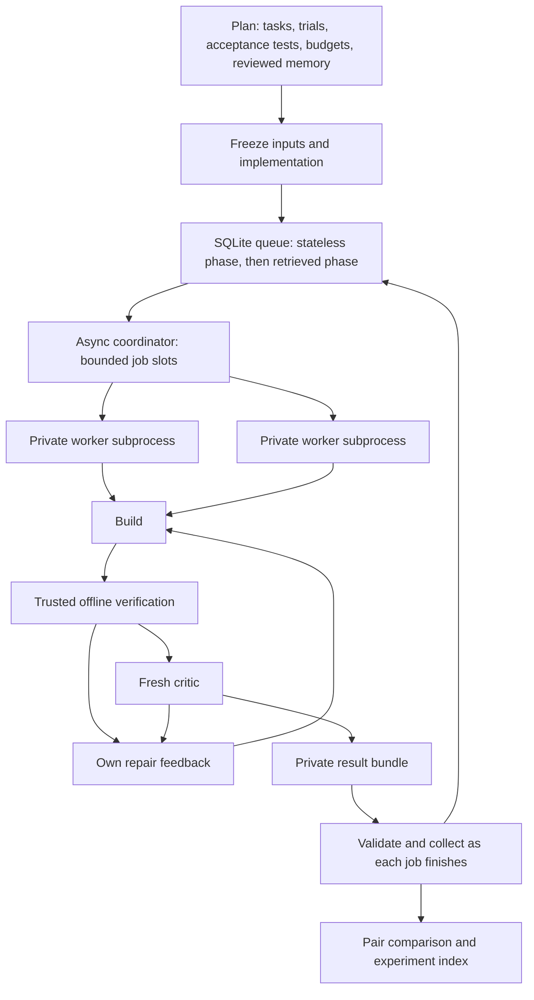

# Modular proof jobs and batch coordination

Run inside Ubuntu/WSL. A job is one theorem × trial × condition. Each job has a
private bounded proof loop; different jobs can overlap. All stateless jobs
finish before any retrieved job starts. Both partners begin with the same task
files and generic initial `import Mathlib` submission. Retrieved builders get
the approved memory snapshot; critics retain their independent review role.



## Start a batch

The example uses two trials of the existing binary-tree proof task and makes
four jobs. Change its `tasks` list to add independently prepared proof tasks.
The task config provides source, acceptance rubric, model, tools, pass cap,
stage budgets, image, and memory. Every memory snapshot needs an explicit
review excluding that task's completed answer.

```bash
python3 pipeline/batch.py plan \
  --spec pipeline/examples/proof-batch.json \
  --name exp-my-proof-batch

python3 pipeline/batch.py status --experiment experiments/exp-my-proof-batch

python3 pipeline/batch.py search --experiment experiments/exp-my-proof-batch \
  --query 'perturbation OR assumption'

# Starts fresh builders and critics; consumes model quota.
python3 pipeline/batch.py run --experiment experiments/exp-my-proof-batch
```

Planning makes no model calls. It freezes task copies, memory, condition
assignments, budgets, and the active implementation before executing a job.
Workers use the archived implementation. `--auth` names a file outside the
repository; credentials are never copied into the experiment.

Running the same command after an interruption resumes queued jobs. Completed
jobs are never replayed. A job interrupted while running becomes an
infrastructure error with its evidence retained; retries require a fresh batch.
The coordinator holds an exclusive lock to prevent two writers claiming the
same queue. Interrupted worker processes and containers are cleaned using the
exact job identity; no experiment files are removed.

Collected result bundles and candidate lessons are indexed in SQLite FTS5.
`search` returns matching job IDs and snippets for a human or a later planning
agent. Search results are never automatically exposed to running proof jobs.

## Small reusable interfaces

| Module | Responsibility |
| --- | --- |
| `stages.py` | `build`, `verify`, `critique`, `repair_feedback`, and one sequential `execute` pass |
| `passes.py` | Prepare/freeze each pass; `run_condition` for a single job; bounded repairs and metrics; legacy `run_pair` |
| `worker.py` | Run one condition in a private subprocess with stage resource leases and heartbeat |
| `resources.py` | Process-shared model/Lean slots, atomic private files, heartbeat |
| `batch.py` | Offline plan, durable queue, async scheduling, validation, collection, pair comparison, resume |
| `engine.py` | Existing Docker isolation, formal verifier, model proxy, protected mounts |
| `artifacts.py` | Private per-job records and candidate lessons; no automatic reuse promotion |

`stages.execute(engine, condition, gate=...)` takes a stage context manager.
The default context does nothing, preserving existing single-run behavior.
The worker supplies a context that leases resources and publishes its stage.
This keeps scheduling concerns out of mathematical review and feedback logic.

## Resource limits

`jobs` bounds simultaneous worker subprocesses. `model_calls` bounds model
stages. `lean_builds` bounds stages that can run Lean, including the entire
builder and critic sessions because they can invoke the compiler internally.
The latter is deliberately conservative. Model stages consistently acquire a
model slot before a build slot, avoiding lock-order deadlocks.

RAM admission requires `jobs * (container GiB + 3 GiB)` to fit `ram_gib`;
the extra allowance covers tmpfs/proxy overhead. Docker still enforces the
configured per-container memory, CPU, and process limits. This budget is an
explicit capacity choice, not an automatic measurement of free host RAM.

`job_seconds` is a whole-job wall-time deadline, including resource waits and
all passes. Existing builder/critic and verifier deadlines remain active too.
The coordinator kills the worker process group and cleans its Docker resources
on expiry. Heartbeats expose `waiting:stage` versus active work through `status`.

Start with one or two slots. Compare throughput, timeouts, model usage, and
peak host RAM before increasing concurrency. Equal call counts alone do not
guarantee equal cost: retries and context lengths can change usage.

## Evidence and interpretation

```text
experiments/<batch>/
  plan.json, batch-manifest.json   immutable plan and hashes
  runtime-source/pipeline/        archived implementation
  queue.sqlite3                  coordinator-owned job state
  comparison.json                completed stateless/retrieved pairs
  artifacts/index.md             curated experiment summaries
  artifacts/jobs.md              coordinator-written result links
  runs/<job_id>/
    experiment.json, frozen-manifest.json, inputs/, memory/, evaluator/
    heartbeat.json, worker.log, result.json, collected-result.json
    <condition>/passes/pass-NNN/  proof, logs, verifier, critic, feedback
    artifacts/                   private run summaries and candidate lessons
```

Acceptance requires both the formal gate and a valid critic pass. Formal
failures and critic rejections can use the remaining repair budget; uncertainty
stops for human review. Invalid reports, missing output, process failures, and
timeouts remain infrastructure errors. Measurements unavailable from model
events remain `unknown`.

Compare acceptance first, then passes, time, compiler events, tokens, and cost.
The coordinator publishes each finished pair without waiting for the rest.
Stateless and retrieved jobs share no live artifacts or chat history.

The cumulative-transfer box in the diagram is a later experiment boundary:
finish both conditions, review general lessons, exclude the next target's
answer, then freeze a new batch. This runner never promotes candidate lessons
or injects newly produced stateless answers into retrieved jobs automatically.
