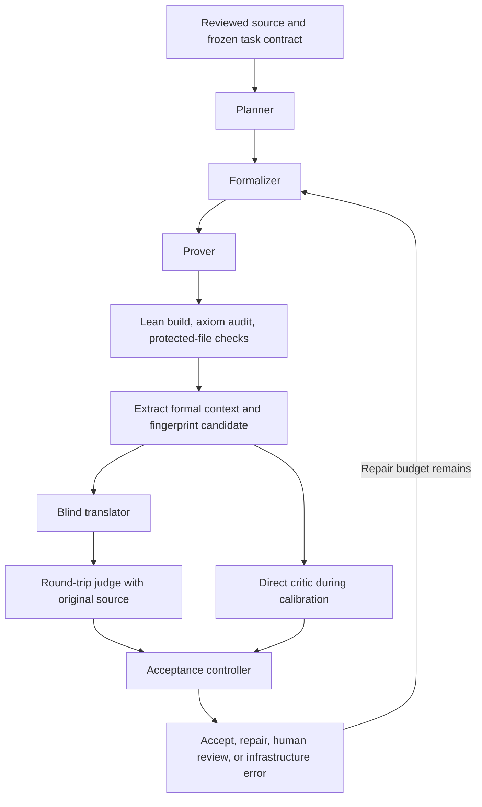

# Pipeline revision plan: separate agents and round-trip judgment

Status: implemented and automatically verified in opt-in calibration mode; expert adjudication pending.
Updated: 2026-11-01.
Branch: `codex/modular-proof-pipeline`.

## Research objective

Determine whether curated external research artifacts improve the production of
semantically faithful, Lean-verified applied-mathematics constructions and proofs
under a fixed total resource budget.

Keep the existing execution harness. Separate production responsibilities across
agents, and introduce blind back-translation followed by round-trip judgment as
the primary proposed semantic evaluator. Validate its accuracy before replacing
the existing direct critic. Superiority over the critic is a hypothesis.

The prospective contribution is the controlled study of artifact memory in this
architecture, including construction fidelity and evaluator calibration. Novelty
relative to related work still requires a literature assessment.

## Current implementation

- Frozen plans, durable queue, archived coordinator/workers, resource limits,
  result collection, artifact search, and paired comparison already exist.
- Historical runs retain their builder, trusted verification, direct critic, and
  bounded same-condition repair. New revision configurations run separate
  planner, formalizer, and prover sessions with versioned handoffs.
- The revised formal gate builds and scans the project, audits transitive axioms
  of every imported project declaration, and protects prerequisite files and
  the formalizer's theorem types and definitions from silent prover edits.
- The live dot-product pair succeeded on the first pass in both conditions:
  approximately 151 seconds stateless and 175 seconds retrieved for the proof
  loop. Five proved prerequisites were supplied equally. This demonstrates
  functionality, not a memory advantage.
- Separate production agents, elaborated formal-context extraction, blind
  translation, structured round-trip judgment, conservative calibration routing,
  and per-role accounting are implemented. See [implementation guide](ROUNDTRIP.md).
- Expert adjudication and the larger multi-task study remain future work.
- Automated checks pass: 86 Python tests, the full repository Lean gate, six
  dot-product development cases after the delivery correction, three explicit-
  construction cases, and one live dot-product pair through all separate agents.
  Both conditions were accepted; this establishes integration, not a memory
  benefit or general semantic-evaluator accuracy. Failures and limitations are
  retained in the [implementation report](../experiments/exp-026-multi-agent-dot-product-pair-2026-11-01/REPORT.md).

References: [current batch guide](BATCH.md),
[live dot-product report](../experiments/exp-017-dot-product-live-pipeline-2026-10-29/REPORT.md).

## Agents and responsibilities

| Agent | Responsibility | Saved output |
| --- | --- | --- |
| Planner | Decompose the original problem into constructions, lemmas, dependencies, and obligations. | `plan.json` |
| Formalizer | Define requested objects and formulate Lean statements matching the source. | Lean definitions, statement record, source-to-formal mapping |
| Prover | Complete proofs with Lean feedback; explicitly propose any statement change. | Candidate Lean files and attempt record |
| Blind translator | Translate the actual formal objects and theorem statements into ordinary mathematics. | `translation.json` |
| Round-trip judge | Compare the translation against the original problem and context. | `roundtrip.json` |

Each invocation is a fresh session. Communication uses explicit files within
the same job. Roles are not extra execution slots: a job's loop is sequential,
while independent jobs can overlap. Deterministic harness stages perform builds,
axiom audits, protected-file checks, schema validation, accounting, and routing.
Human adjudication remains separate from automatic model judgments.

## Task contract

Before assigning a condition, freeze the original source passage and surrounding
assumptions, acceptance criteria, tools, model settings, approved prerequisites,
role budgets, whole-job budget, and memory snapshot. Have the mathematical
assumptions checked for consistency and adequacy.

Classify the deliverable as a theorem, explicit answer/formula, algorithm, or
representation transformation. Construction tasks require the actual object and
a theorem about that object; an existence proof or an arbitrary sequence assumed
to have the desired property may not satisfy that contract.

Keep paper-to-Lean formalization open-ended: specify mathematical deliverables
without supplying a locked final Lean theorem. Fixed-statement benchmark tasks
can be studied separately and labeled accordingly.

Inspect construction bodies and dependencies. A `def` keyword or raw-parameter
signature alone does not prevent nonconstructive shortcuts. Distinguish an
explicit mathematical formula from an executable implementation. Classical
reasoning inside proofs is not automatically a defect. For dot-product backward
error, define the rounded algorithm, but allow the intended existential
conclusion about a suitable perturbed input.

## Proposed evaluation flow

1. Record and review proposed statement changes. The prover must not silently
   weaken assumptions, quantifiers, or conclusions to close a goal.
2. Build all submitted modules, audit final theorem axiom dependencies, reject
   placeholders/unapproved axioms, and compare protected prerequisites and
   configuration against frozen hashes.
3. Extract actual elaborated theorem types, implicit parameters, typeclass
   assumptions, relevant definition bodies, and sufficient custom-predicate
   context. Avoid relying on regex extraction or declaration names alone.
4. Fingerprint the translation bundle and its dependency/environment context.
   Every translation and judgment identifies the exact candidate assessed.
   Changes affecting meaning require reevaluation.
5. Give the translator only this formal bundle. Exclude the original problem,
   source-derived comments/docstrings, builder explanations, research memory,
   condition labels, and previous verdicts. Missing context must produce
   `insufficient_context`, not guessed mathematics.
6. Give the judge the original problem/context, blind translation, and task
   contract. Do not expose builder reasoning or the direct critic's verdict
   before it makes its own decision.

Run the existing direct critic independently during calibration. Make round-trip
judgment the primary semantic gate only after reviewing its error rates and
limitations. Preserve a direct-audit option for disputed cases.

## Report and acceptance policy

Use versioned, machine-validated reports containing candidate/bundle hashes,
evaluator configuration, evidence, specific mismatches, and corrections. Record
whether the translated claim implies the original and vice versa, allowing
`uncertain` rather than unsupported binary judgments.

Judgment schema 2 additionally separates logical implication from completed
formal delivery and construction completeness. A judge must not mentally prove
a missing bridge between supporting lemmas and count that as a completed Lean
result. This requirement follows a preserved false pass in the initial six-case
calibration (`exp-021`); the direct critic caught that case and stopped acceptance.

Check quantifiers, assumptions, domain, conclusion, bounds, construction
completeness, and linkage to the submitted construction. Judge meaning rather
than names or syntax. Account for implicit source assumptions and equivalent
encodings of existential witnesses. Accept a stronger result only when it
recovers the original claim and meets the construction contract. Partial domain
coverage fails a full universal target, even if another rubric gives partial credit.

Acceptance requires every mechanical gate and a supported semantic pass.
During calibration, unresolved direct/round-trip disagreement goes to human
review. Definite repairable mismatches return concise feedback within the budget.
Uncertainty stops automatic acceptance. Invalid reports, timeouts, and service
failures are infrastructure outcomes, not theorem failures.

## With-artifact versus without-artifact experiment

Use the same five-role architecture and role budgets in both conditions.

| Condition | Production-agent inputs |
| --- | --- |
| Stateless | Task, common prerequisites, and this job's own plan and repair feedback |
| Retrieved | Identical inputs plus an approved frozen snapshot of prior research artifacts |

Only the retrieved planner, formalizer, and prover may access research memory.
Translator and judge receive no research memory or condition label in either
condition. Their interfaces, models, and budgets remain equal.

Exclude evaluated target proofs and near-duplicate solutions from the snapshot.
Keep mathematical prerequisites identical: an extra proved prerequisite in one
condition would confound the artifact comparison. For each production role,
record searches, opened artifact IDs, and actual decisions influenced. Mounted
memory alone is not evidence of a benefit.

Use one fixed snapshot for the first study. Do not inject new stateless answers
into retrieved jobs. Cumulative transfer is a later experiment: finish both
conditions, review general lessons, exclude the next target answer, and freeze
the next snapshot. This studies external memory, not changes to model weights.

## Accuracy and experimental design

First calibrate on existing correct dot-product proofs and compiling defects:
proposition-only, missing algorithm linkage, restricted quantification, added
assumptions, circular conclusions, and existence substituted for an explicit
construction. Include valid equivalent and renamed formulations to test false
rejections. Expected labels stay hidden from all agents.

Have a Lean-experienced reviewer adjudicate disagreements and randomly sampled
accepted and rejected cases. Preserve raw model verdicts and adjudicated labels
separately. Two LLM stages agreeing is not a correctness certificate. Different
evaluator model families may reduce some shared biases but do not replace review.

After calibration, use three advisor-approved numerical-analysis tasks, three
independent trials per condition: 18 jobs. Split development and held-out
evaluation by theorem family, not mutations of one theorem. Include a task
requiring meaningful decomposition or a new intermediate lemma.

Primary outcome: expert-validated semantic success within the preregistered
budget. Also report construction completeness, formal success, false acceptance,
false rejection, uncertainty, disagreement, repairs, time, and tokens. Keep
unavailable cost and other measurements `unknown`.

Account for total production and evaluation resources across all agents. Specify
how evaluator feedback is used and preserve pre-feedback candidate judgments.
The current coordinator runs stateless jobs first. Retain that behavior for
initial compatibility, record the order limitation, and decide before the main
study whether to counterbalance order to reduce time/cache/service confounding.
Do not infer a causal memory benefit from one successful pair.

## Implementation milestones

1. Add planner/formalizer/prover interfaces and versioned same-job handoffs,
   reusing the current bounded loop and resource controls.
2. Add mandatory theorem-level axiom auditing and protected-file comparisons,
   with a per-task approved axiom/construction policy.
3. Add elaborated-context extraction, blind translation, structured judgment,
   and candidate-version checks as independently testable modules.
4. Calibrate with labeled cases and expert adjudication; freeze the acceptance
   policy before comparing artifact conditions.
5. Run one dot-product pair as an integration test, then the small multi-task
   study. Preserve failures, regressions, prompts, reports, and measurements.

## Questions for advisor review

- Which tasks and prerequisite boundary best test the research question?
- What counts as an explicit construction, and is execution required?
- Who can review task statements, disagreements, and sampled outcomes?
- What accuracy and review-coverage thresholds permit automatic acceptance?
- Which lessons are admissible memory, and how will answer leakage be checked?
- What total budget and condition-order policy should be preregistered?

## Related work informing the design

- *Formalizing Numerical Analysis: An Agent Pipeline and Quality Audit Beyond
  Kernel Acceptance*: fresh-session roles, semantic audit, and blind
  back-translation/round-trip evaluation. Supplied locally as `PipelineExample.pdf`.
- *Construction-Verification: A Benchmark for Formalizing Applied Mathematics in
  Lean 4* (AMBER, arXiv:2602.01291): explicit construction plus verification,
  with evaluation/algorithm/transformation task categories.

These motivate the design. Their results do not establish the accuracy of our
proposed evaluator or a benefit from our artifact memory.
